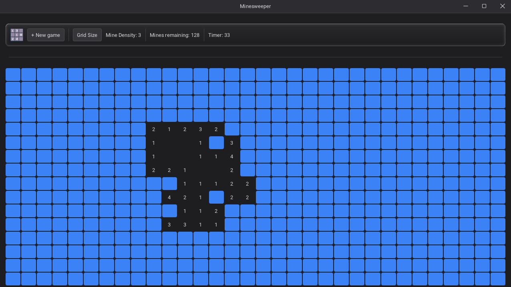
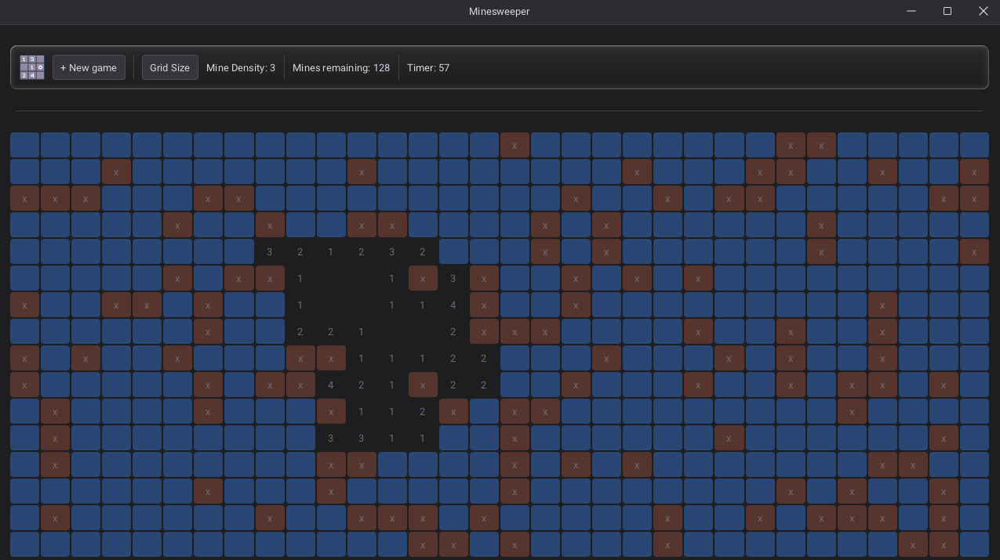
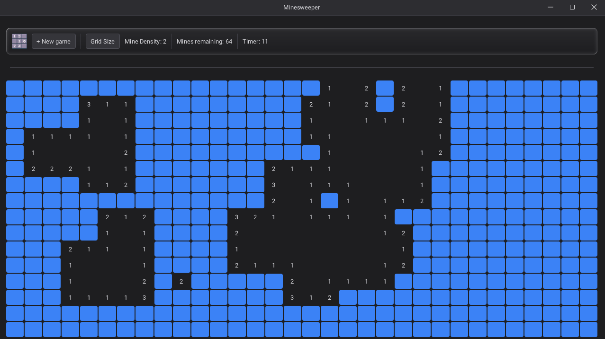

# Minesweeper

This is an attempt at making my own Minesweeper using the new and bloated vibecoded GUI library "Raven".
The goal of this project was for me to try out Raven and learn more about programming in C.

## State

The current features are implemented:
- Start a game/ board generation
- Change mine density
- Timer and mine counter
- Loss detection

The main missing features are:
- Flagging cells
- Smarter discovery (chording)
- Win detection

## Screenshots

A regular game:

Lost board view (mines are shown):

Cascade discovery of empty zones:

## Project structure

Main logic and UI is handled by :
- [`main.c`](main.c)
- [`minesweeper.c`](minesweeper.c)
- [`minesweeper.h`](minesweeper.h)

Assets and UI description is stored in [`views`](views).

The version of Raven utilized lies in [`lib/raven`](lib/raven). 
Since the [actual library](https://github.com/oscar-soirey/Raven) is being updated very often and is still 
in active development, API may break if you use the latest release.

## Build the project

1. Clone the repository `git clone`
2. Configure the build directory : `cmake -S . -B build`
3. Compile : `cmake --build build`

At this point, this should be cross-platform but has only been tested on Linux.

## Conclusion

The UI was designed with the "Raven Designer" utility provided with Raven. The experience is fairly straightforward and easy.

Resources usage:
- Binary size: 1.8 MB (can be stripped to 1.6)
- RAM consumption: 30 MB

Using Raven is a pleasing experience, but the following aspects of it makes it difficult to endorse to others :
- *Very* young library (API may likely change, little community and global knowledge)
- Highly vibecoded: The developer is implementing a big amount of features rapidly using AI. 
This is worrying since it may turn into a big amount of technical debt in the future.
